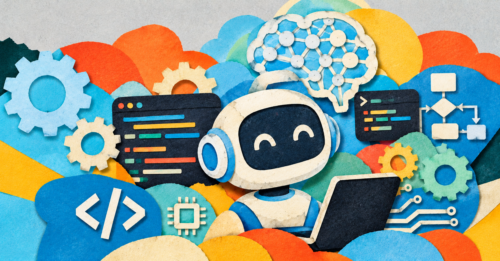

Ostatnio zastanawiałem się, czy programiści nie są trochę jak ludzie, którzy kiedyś zajmowali się transportem konnym. Przez lata wiedzieli, jak sprawnie przewozić ludzi i towary, aż pojawiły się samochody. Nagle okazało się, że można robić to inaczej, szybciej i na większą skalę.

Pewnie nie każdy dorożkarz z dnia na dzień stracił pracę, ale sam sposób wykonywania tego zawodu zaczął się zmieniać. I mam wrażenie, że z programowaniem dzieje się teraz coś podobnego. Tylko zamiast samochodów mamy AI, a zamiast koni… no właśnie, nasze klawiatury.

Jeszcze kilka miesięcy temu uważałem, że AI nie zastąpi programistów. Dziś nie jestem już tego taki pewien. Nie dlatego, że sztuczna inteligencja potrafi wszystko. Po prostu widzę, jak szybko zmienia się nasza praca.

## Kod jest narzędziem, nie celem

Od wielu miesięcy praktycznie nie piszę ręcznie kodu. Opisuję problem, dostarczam kontekst i nadzoruję pracę agentów AI. A systemy nadal się rozwijają, błędy są naprawiane, nowe funkcjonalności trafiają do projektów. Czyli coś tam jednak powstaje.

W projektach programistycznych nie chodzi przecież o samo pisanie kodu. Naszym zadaniem jest dostarczenie działającego systemu, który spełnia wymagania i da się utrzymywać przez kolejne lata.

Jeśli AI potrafi przygotować dobre rozwiązanie, klientowi raczej nie robi różnicy, kto napisał poszczególne linijki.Dlatego coraz mniej przekonuje mnie argument, że programistów nie da się zastąpić, bo kod przecież musi napisać człowiek. Nie musi. Ważniejsze jest to, czy ktoś potrafi określić, co należy zbudować, a później ocenić, czy powstałe rozwiązanie ma sens.

## Moja praca wygląda już inaczej

Zamiast samodzielnie implementować zmiany, staram się dostarczyć agentowi jak najwięcej kontekstu. Udostępniam kod źródłowy, opisuję zależności między serwisami i wskazuję miejsca, które mogą wymagać modyfikacji.

Samo przygotowanie dobrego opisu potrafi zająć trochę czasu. Trzeba pomyśleć o szczegółach, które łatwo pominąć, i przewidzieć przypadki brzegowe. Ale kiedy agent dostanie odpowiednie informacje, potrafi wykonać sporą część pracy za mnie.

Zmienia się też sposób komunikacji. Korzystając z Wispr Flow, coraz częściej po prostu mówię zamiast pisać długie prompty. Łatwiej mi przekazać kilka minut szczegółowych przemyśleń, niż próbować zmieścić wszystko w krótkim poleceniu.

Moja rola coraz bardziej polega na kierowaniu pracą agenta i sprawdzaniu tego, co przygotował. Mniej klepania kodu, więcej zastanawiania się, czy to, co właśnie powstało, ma w ogóle sens.

## Istniejący projekt to nie to samo co budowanie od zera

Największe korzyści widzę przy rozwijaniu istniejących systemów i naprawianiu błędów. Agent ma już kod, na którym może się oprzeć. Widzi strukturę projektu i potrafi dopasować poprawkę do przyjętego stylu.

Inaczej jest przy nowych projektach. Kiedy tworzyłem serwis w .NET od zera, agent generował tyle dodatkowych atrybutów w kontrolerach i elementów konfiguracji, że część z nich była dla mnie nowością.

Nie twierdzę, że ten kod był błędny. Musiałem jednak zastanowić się, czy wszystkie te elementy są potrzebne i czy rzeczywiście chcę wprowadzać je do projektu.

I tu pojawia się pewien haczyk. AI potrafi napisać kod, którego sam nie napisałbym w taki sposób. Czasami rozwiązanie jest całkiem dobre. Innym razem zastanawiam się, czy naprawdę potrzebujemy aż takiej kombinacji.

W istniejącym systemie agent ma przynajmniej jakiś punkt odniesienia. W nowym sam proponuje wiele decyzji, a my musimy pilnować, żeby z prostej aplikacji nie zrobił małego promu kosmicznego.

## Kto odpowiada za kod wygenerowany przez AI?

Ostatecznie to ja zatwierdzam zmiany i dopuszczam je do wdrożenia. Nie mogę powiedzieć, że za błąd odpowiada agent, skoro to ja zaakceptowałem jego pracę.

Dlatego code review jest dziś dla mnie równie ważne jak wcześniej, a być może nawet ważniejsze. Trzeba rozumieć, co zostało zmienione, i sprawdzić, czy poprawka nie wprowadza nowych problemów.

Nadal staram się dzielić pracę na mniejsze zadania. Łatwiej wtedy ocenić zmiany i przetestować ich działanie. Nie ma sensu zlecać agentowi wszystkiego naraz, a potem patrzeć na ogromnego pull requesta i zastanawiać się, od czego właściwie zacząć.

AI przyspiesza implementację, ale nie zwalnia nas z odpowiedzialności. Przynajmniej na razie nie widziałem, żeby agent sam poszedł na spotkanie z klientem i wyjaśnił, dlaczego coś nie działa.

## Czy programowanie traci swoją magię?

To chyba najtrudniejsza część tej zmiany.

Zawsze lubiłem rozwiązywać trudne problemy. Wielogodzinne debugowanie, odkrywanie nieoczywistych zależności i moment, w którym po długiej analizie w końcu znajdowałem rozwiązanie, dawały mi ogromną satysfakcję. Dziś agent AI potrafi czasem rozwiązać podobny problem podczas jednej sesji.

Cieszę się, że system działa i że zadanie udało się szybko zamknąć. Jednocześnie coraz wyraźniej odczuwam, że tracę przyjemność z samego programowania. Brakuje mi części procesu tworzenia, eksperymentowania i samodzielnego dochodzenia do rozwiązania.

Może z czasem się do tego przyzwyczaję. Na razie mam jednak poczucie, że wraz z automatyzacją tracimy coś, co dla wielu z nas było jedną z najciekawszych części tego zawodu.

Trochę tak, jakby ktoś powiedział mi, że od jutra nie muszę już grać na instrumencie, bo komputer zrobi to szybciej i bez fałszowania. Niby świetnie, ale czy o sam efekt końcowy zawsze chodziło?

## Nie bójmy się tej zmiany

Kiedyś pisaliśmy kod w prostych edytorach. Później pojawiły się IDE, inteligentne podpowiedzi i narzędzia takie jak ReSharper, które automatyzowały wiele powtarzalnych czynności. AI jest kolejnym krokiem, tyle że tym razem skala zmian jest znacznie większa.

Nie widzę sensu w kurczowym trzymaniu się ręcznego pisania kodu tylko dlatego, że tak pracowaliśmy do tej pory. Z perspektywy biznesu liczy się przede wszystkim działający system i wartość, którą dostarczamy klientowi. To nie oznacza, że wiedza techniczna przestaje być potrzebna. Przeciwnie, bez niej trudno ocenić, czy agent rzeczywiście wykonał dobrą robotę.

Pozostaje jeszcze kwestia kosztów. Dziś dostęp do AI może być stosunkowo przystępny, ale nie wiemy, jak zmienią się ceny, gdy firmy jeszcze mocniej uzależnią swoje procesy od tych narzędzi.

Może więc zamiast zastanawiać się, czy AI zabierze nam pracę, lepiej sprawdzić, jak możemy z niej korzystać. Dorożkarze nie zatrzymali rozwoju motoryzacji, a my raczej nie zatrzymamy rozwoju AI. Możemy za to nauczyć się jeździć tym nowym samochodem, zanim ktoś inny zacznie nas nim wozić.

## A może AI zmienia nie tylko programowanie?

Jest w tym wszystkim pewien paradoks. Piszę artykuł o tym, jak AI przejmuje pracę programisty, a sam tekst powstał dokładnie w podobny sposób.

Cały artykuł został przeze mnie wypowiedziany. Następnie agent AI pomógł mi uporządkować myśli i przeredagować je w formę, którą właśnie czytasz.

Nie musiałem zaczynać od pustej strony ani mozolnie układać każdego zdania. Musiałem za to wiedzieć, co chcę powiedzieć.

I może właśnie na tym polega większa zmiana. AI nie tylko pomaga nam programować. Zmienia również sposób, w jaki piszemy, tworzymy i przekazujemy własne myśli.

Czy programiści przestaną pisać kod? Być może część z nas już przestała. Ale czy to oznacza, że przestaliśmy programować?

Tego jeszcze nie wiem. Za to wiem, że właśnie przeczytałeś artykuł, którego autor nie napisał ręcznie ani jednego zdania. No dobra, przynajmniej nie na klawiaturze.
